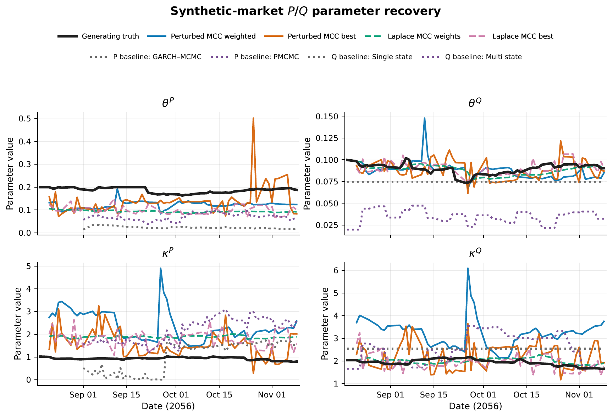

# Online Measure-Coupled Calibration (MCC)

This repository contains the implementation and experiments for **Measure-Coupled Calibration (MCC)**, an online framework for jointly learning stochastic-volatility dynamics from asset returns under the physical measure \(\mathbb{P}\) and option prices under the risk-neutral measure \(\mathbb{Q}\).

The code supports Heston and Bates models, synthetic and real-market datasets, baseline calibrations, error analysis, and the result figures used in the accompanying manuscript.

## Method at a glance

MCC uses a sequential augmented particle filter to update:

- the latent variance path;
- physical-measure model parameters;
- the volatility risk premium connecting \(\mathbb{P}\) and \(\mathbb{Q}\); and
- jump parameters for the Bates model.

For the Heston variance process, the measure change is represented by

$$
\kappa_{\mathbb{Q}} = \kappa_{\mathbb{P}} + \lambda_V,
$$

$$
\theta_{\mathbb{Q}} =
\frac{\kappa_{\mathbb{P}}\theta_{\mathbb{P}}}
     {\kappa_{\mathbb{Q}}}.
$$

At each observation time, particles are weighted using both the return likelihood and the option-surface fit. Resampling and recovery steps then propagate the posterior to the next observation.

```text
returns under P ──┐
                  ├─> joint particle update ─> latent state and parameters
options under Q ──┘
```

## Supported models and data

| Model | Calibration implementations | Included data panels |
| --- | --- | --- |
| Heston | Joint MCC and baseline calibration | Synthetic equity data and real equity data |
| Bates | Joint MCC and baseline calibration | Real cryptocurrency data |

The corresponding code is organized under [`Heston/`](Heston/) and [`bates/`](bates/). The repository includes the following datasets under [`Data/`](Data/):

- `Synthetic_Stock/` — synthetic price and option observations;
- `Real_Stock/` — the real equity panel used by the Heston experiments; and
- `Real_Crypto/` — the real cryptocurrency panel used by the Bates experiments.

## Repository layout

```text
.
├── Heston/                    # Heston joint and baseline implementations
├── bates/                     # Bates joint and baseline implementations
├── Data/                      # Synthetic and real input datasets
├── Output/                    # Calibration outputs
├── Results/                   # Error summaries and experiment results
├── Run inputs/                # Reusable inp.txt configurations
├── error_handlers/            # Post-processing and error analysis
├── figures/                   # Selected manuscript figures
├── inp.txt                    # Active run configuration
├── shell_*calibration.sh      # Build-and-run entry points
└── mcc.tex                    # Full manuscript source
```

## Requirements

The experiments assume a Unix-like shell and the following software:

- a C++17 compiler such as `g++`;
- [QuantLib](https://www.quantlib.org/);
- [Eigen](https://eigen.tuxfamily.org/);
- [LBFGS++](https://lbfgspp.statr.me/) for the baseline calibrations;
- Python 3 with NumPy and pandas for error analysis.

The shell scripts contain machine-specific include and library paths, including paths below `$HOME/local`, `$HOME/local-quantlib-sessions`, and a sibling `eigen-3.4.0` directory. Review and update those paths for your machine before running an experiment.

Run all commands from the repository root. The scripts compile a temporary `run_main` executable and remove it when the run finishes.

## Configuration

Experiments read their settings from [`inp.txt`](inp.txt). Its main fields are:

| Field | Purpose |
| --- | --- |
| `number of particles` | Number of particles in the sequential filter |
| `number of volatility path samples` | Number of latent-volatility path samples |
| `use ESS` | Enables effective-sample-size-based resampling |
| `number of threads` | Worker-thread count |
| `alpha` | Recovery/significance parameter between 0 and 1 |
| `use LMS` | Toggles the LMS-based calibration variant |
| `is daily rate` | Selects daily or monthly rate treatment for baselines |
| `folder path` | Input dataset directory |
| `Output path` | Destination for generated output |

Reusable example configurations are available in `Run inputs/`:

- [`1_inp_synthethic_joint.txt`](<Run inputs/1_inp_synthethic_joint.txt>);
- [`2_inp_synthethic_joint_lms.txt`](<Run inputs/2_inp_synthethic_joint_lms.txt>);
- [`3_inp_real_joint.txt`](<Run inputs/3_inp_real_joint.txt>); and
- [`4_inp_real_joint_lms.txt`](<Run inputs/4_inp_real_joint_lms.txt>).

Copy the desired template to `inp.txt`, then review the data and output paths before launching a run. Existing `inp.txt` contents are overwritten when you copy a template.

## Quick start

After installing the dependencies and correcting the paths in the shell scripts, choose the experiment that matches your model and calibration method.

### Heston

Joint measure-coupled calibration:

```bash
bash shell_heston_joint_calibration.sh
```

Baseline calibration:

```bash
bash shell_heston_baselines.sh
```

To run only the single-series Heston baseline:

```bash
bash shell_heston_baselines.sh --single-only
```

### Bates

Joint measure-coupled calibration:

```bash
bash shell_bates_joint_calibration.sh
```

Baseline calibration:

```bash
bash shell_bates_baselines.sh
```

Runtime depends on the selected data panel, particle count, path-sample count, and thread count. Begin with a small configuration when checking a new installation.

## Outputs and analysis

Calibration runs write model outputs below [`Output/`](Output/). Processed errors and experiment summaries are stored below [`Results/`](Results/).

The post-processing utilities compare joint-calibration estimates with the baseline outputs. Configure [`error_handlers/inp.txt`](error_handlers/inp.txt), then run:

```bash
python3 error_handlers/run_error_handlers.py
```

Additional details about the analysis inputs and generated files are available in [`error_handlers/README.md`](error_handlers/README.md).

## Selected results

### Synthetic latent-volatility recovery


*Static and dynamic latent-volatility paths for the synthetic LMS experiment.*

### Physical- and risk-neutral parameter recovery



*Recovery of \(\kappa\) and \(\theta\) under the physical and risk-neutral measures.*

### Option-surface errors


*Moneyness-bucket RMSE comparison for the cryptocurrency and equity experiments.*

## Manuscript and related artifacts

- [`mcc.tex`](mcc.tex) contains the full LaTeX manuscript and the detailed mathematical development.
- The synthetic datasets used by these experiments are produced by the companion [Synthetic Market Generator](https://anonymous.4open.science/r/Synthetic-Market-Generator/).

This README is intended as an operational guide to the repository. Refer to the manuscript for the full derivations, experimental design, and discussion of results.
