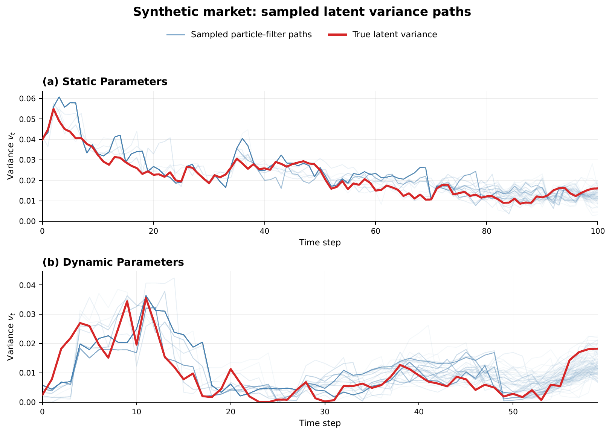
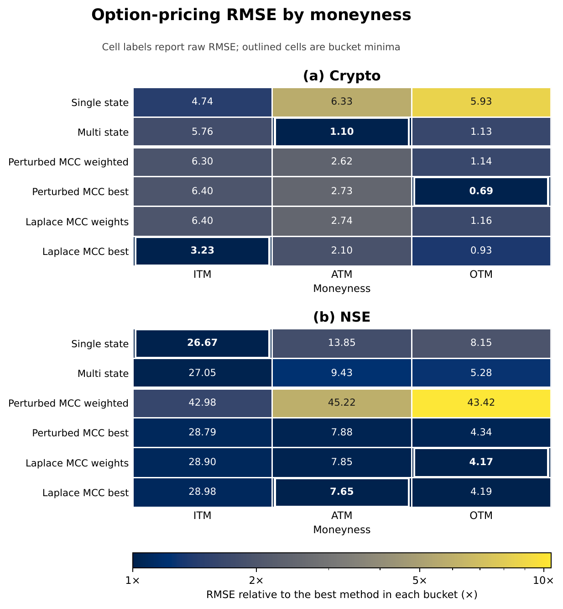

# Online Measure-Coupled Calibration: Joint Inference for Stochastic Volatility from Returns and Option Surfaces

> This is the GitHub-readable Markdown edition of the complete paper in [`mcc.tex`](mcc.tex). LaTeX comments and publisher-specific formatting are omitted; the active manuscript content is preserved. Citation keys are shown inline because the referenced `mcc_bib.bib` file was not included in this artifact.

## Abstract

Stochastic-volatility models are commonly calibrated separately to historical returns and option prices, even though their $\mathbb{P}$- and $\mathbb{Q}$-dynamics are structurally linked. This separation can produce estimates that fit each data source but are inconsistent across measures. We introduce Measure-Coupled Calibration (MCC), a sequential framework for jointly estimating stochastic volatility models from returns under the physical measure $\mathbb{P}$ and option prices under the risk-neutral measure $\mathbb{Q}$. Rather than calibrating the two representations independently, MCC preserves their structural change-of-measure relation.

MCC uses an augmented particle filter to track latent variance, physical-measure parameters, and change-of-measure parameters over time. Particles are propagated sequentially, mapped from $\mathbb{P}$ to $\mathbb{Q}$, and weighted using the return likelihood and option-surface fit. We instantiate the framework with the Heston and Bates models.

We evaluate the framework using Heston on controlled synthetic markets and NSE equity options, and Bates on hourly cryptocurrency option data. The results show that combining information across the two measures improves parameter consistency and latent-state recovery relative to single-measure calibration, while remaining competitive with strong calibration baselines on real-world option-pricing tasks. To support reproducibility and further evaluation, we provide a complete C++ implementation of the calibration framework together with a [QuantLib-based synthetic market generator](../Synthetic-Market-Generator/) for the Heston model.

**Keywords:** stochastic volatility; Heston model; Bayesian calibration; particle filtering; QuantLib; option pricing

**CCS concepts:** Computing methodologies—Modeling and simulation; Applied computing—Economics

## Introduction

Stochastic volatility models are widely used to describe asset-return dynamics and price derivative securities. Historical returns evolve under the physical measure $\mathbb{P}$, whereas derivative prices are computed under an equivalent risk-neutral measure $\mathbb{Q}$, under which the discounted asset price is a martingale. The two parameterizations are linked through the market prices of risk rather than being independent (citation keys: heston1993,bates1996,shreve2004).

Despite this connection, calibration under the two measures is usually carried out separately. Physical-measure parameters are inferred from historical returns using likelihood-based, Bayesian, or time-series methods, whereas risk-neutral parameters are obtained by fitting observed option prices or implied volatilities (citation keys: fruehwirth2008,stramer2011bayesian,cui2017full,mrazek2017calibration). This separation is convenient, but it does not enforce the restrictions imposed by the change of measure; parameter estimates may therefore fit each data source in isolation while remaining incompatible across measures (citation keys: chernov2000joint,pan2002jump).

The problem is particularly noticeable for stochastic volatility models such as Heston and Bates. Different parameter combinations can generate very similar option-price surfaces, making the inverse calibration problem practically ill-conditioned (citation keys: gatheral2006,cui2017full,mrazek2017calibration). Option prices may therefore constrain the risk-neutral dynamics without uniquely determining the corresponding physical dynamics or risk premia (citation keys: chernov2000joint,forbes2007inference,hurn2015estimating). A good fit under $\mathbb{Q}$ does not necessarily imply a coherent model under $\mathbb{P}$.

Joint estimation provides a natural way to reduce this ambiguity: returns constrain the physical dynamics, while option prices constrain the associated risk-neutral representation through the change-of-measure relation. Existing approaches include moment-based, likelihood-based, and Bayesian simulation methods applied to fixed observation samples (citation keys: chernov2000joint,pan2002jump,forbes2007inference,hurn2015estimating). In practice, calibration is repeated as new returns and option surfaces arrive, while latent volatility and fitted parameters may evolve over time (citation keys: lindstrom2008sequential). Re-solving the complete batch problem at every observation can therefore be computationally expensive and can discard useful temporal information.

This paper introduces Measure-Coupled Calibration (MCC), an online framework for jointly estimating stochastic-volatility models across the physical and risk-neutral measures. MCC sequentially tracks latent variance, physical parameters, and change-of-measure parameters, using returns to constrain the real-world dynamics and option surfaces to constrain their structurally linked risk-neutral representation. Option-based initialisation and adaptive particle recovery improve stability under changing market conditions. We evaluate MCC on synthetic Heston markets, NSE equity options, and hourly cryptocurrency options using the Bates model. MCC improves cross-measure consistency and latent-state recovery relative to single-measure estimators while remaining competitive on real-market calibration and return prediction. Our main contributions are as follows:

  - We formulate Heston and Bates calibration as an online cross-measure inference problem that jointly tracks latent variance, physical-measure parameters, the volatility risk premium, and, for Bates, the jump parameters.

  - We develop an augmented particle filter that retains information from previous observations, tracks parameter uncertainty over time, and combines physical-measure return likelihoods with risk-neutral option-surface information through the structural $\mathbb{P}$-to-$\mathbb{Q}$ transformation.

  - We evaluate MCC using Heston on synthetic markets and NSE equity options, and Bates on hourly cryptocurrency options, with comparisons against physical-only, risk-neutral-only, and rolling multi-surface calibration baselines.

  - We release a C++ implementation together with a QuantLib-based synthetic market generator for reproducible evaluation of Heston and Bates calibration methods.

## Related Work

Estimation of stochastic volatility models is commonly separated by probability measure. Under $\mathbb{P}$, latent variance and model parameters are inferred from returns using likelihood-based, Bayesian, or state-space methods (citation keys: fruehwirth2008,andrieu2010particle,stramer2011bayesian); under $\mathbb{Q}$, parameters are calibrated to option prices or implied volatilities (citation keys: cui2017full,mrazek2017calibration). These procedures fit their respective data sources but do not enforce cross-measure consistency.

Joint estimators have combined spot and option observations to infer physical and risk-neutral parameters, volatility and jump-risk premia, and latent variance (citation keys: chernov2000joint,pan2002jump,forbes2007inference, aihara2006filtering,hurn2015estimating). These methods primarily perform batch inference over fixed samples with static structural parameters. Separately, Lindström et al. (citation keys: lindstrom2008sequential) used nonlinear Kalman filters to track time-varying Heston and Bates parameters sequentially, but relied mainly on risk-neutral option data.

MCC combines these directions. It maintains an augmented particle population over latent variance, physical parameters, and change-of-measure parameters, assimilates returns and option surfaces within the same sequential update, and enforces the $\mathbb{P}$-to-$\mathbb{Q}$ map for every particle. Unlike batch joint estimators, MCC updates online and permits controlled parameter evolution; unlike option-only sequential calibration, it uses returns to constrain the cross-measure decomposition. Laplace initialisation places particles in locally plausible regions of the ill-conditioned surface-calibration problem.

## Background and Problem Formulation

### Heston Dynamics Under the Physical Measure

Let $S_t$ denote the price of the underlying asset and let $V_t$ denote its latent instantaneous variance. Under the physical measure $\mathbb{P}$, the Heston stochastic volatility model is given by (citation keys: heston1993) $$\begin{aligned}
\frac{dS_t}{S_t}
&=
\mu\,dt
+
\sqrt{V_t}\,dW_t^{S,\mathbb{P}},

\\
dV_t
&=
\kappa_{\mathbb{P}}
\left(
\theta_{\mathbb{P}}-V_t
\right)dt
+
\xi\sqrt{V_t}\,dW_t^{V,\mathbb{P}}.
\end{aligned}$$ where $$dW_t^{S,\mathbb{P}}
dW_t^{V,\mathbb{P}}
=
\rho\,dt.
$$ Here, $\mu$ is the physical drift of the asset, $\kappa_{\mathbb{P}}>0$ is the mean-reversion rate of the variance process, $\theta_{\mathbb{P}}>0$ is its long-run mean, $\xi>0$ is the volatility-of-variance parameter, and $\rho\in[-1,1]$ controls the instantaneous correlation between return and variance innovations. The parameter vector under the physical measure is denoted by $$\boldsymbol{\vartheta}_{\mathbb{P}}
=
\left(
\mu,
\kappa_{\mathbb{P}},
\theta_{\mathbb{P}},
\xi,
\rho
\right).$$

For a discrete interval of length $\Delta t$, the log return $$R_t
=
\log
\left(
\frac{S_t}{S_{t-\Delta t}}
\right)$$ can be approximated using an Euler discretization as $$R_t
\approx
\left(
\mu-\frac{1}{2}V_{t-\Delta t}
\right)\Delta t
+
\sqrt{V_{t-\Delta t}\Delta t}\,
\varepsilon_t^{S},
\qquad
\varepsilon_t^{S}\sim\mathcal{N}(0,1).
$$ Historical log returns therefore provide information about the latent variance path and the physical-measure dynamics. However, because $V_t$ is unobserved, the likelihood of the observed returns requires either explicit latent-state estimation or integration over the latent variance process.

### Risk-Neutral Dynamics and Option Pricing

Derivative option prices are computed under an equivalent risk-neutral measure $\mathbb{Q}$, under which the discounted asset price is a martingale (citation keys: heston1993,shreve2004). The Heston dynamics become $$\begin{aligned}
\frac{dS_t}{S_t}
&=
(r_t^{f}-q_t)dt
+
\sqrt{V_t}\,dW_t^{S,\mathbb{Q}},

\\
dV_t
&=
\kappa_{\mathbb{Q}}
\left(
\theta_{\mathbb{Q}}-V_t
\right)dt
+
\xi\sqrt{V_t}\,dW_t^{V,\mathbb{Q}}.
\end{aligned}$$ with $$dW_t^{S,\mathbb{Q}}
dW_t^{V,\mathbb{Q}}
=
\rho\,dt.$$ Here, $r_t^{f}$ is the risk-free interest rate. The current latent variance $V_t$ is shared by the physical and risk-neutral representations, but its future dynamics are governed by the risk-neutral parameters $\kappa_{\mathbb{Q}}$ and $\theta_{\mathbb{Q}}$.

For a European call option with strike $K$ and time to maturity $\tau$, the arbitrage-free price is $$C_t(K,\tau)
=
e^{-r_t^{f}\tau}
\mathbb{E}^{\mathbb{Q}}
\left[
\left(
S_{t+\tau}-K
\right)^{+}
\mid
\mathcal{F}_t
\right].
$$ The Heston model admits a semi-analytical characteristic-function representation for evaluating Equation `risk_neutral_price` (citation keys: heston1993). In our implementation, option prices are computed using the corresponding QuantLib pricing engines (citation keys: quantlib).

At time $t$, we denote the observed option panel by $$\mathcal{O}_t
=
\left\{
\left(
K_{t,j},
\tau_{t,j},
C_{t,j}^{\mathrm{mkt}}
\right)
\right\}_{j=1}^{M_t},$$ where $M_t$ is the number of available option contracts. The option panel constrains the risk-neutral parameters through the pricing map $$C_{t,j}^{\mathrm{model}}
=
\mathcal{H}
\left(
S_t,
V_t,
K_{t,j},
\tau_{t,j},
r_t^{f},
q_t;
\boldsymbol{\vartheta}_{\mathbb{Q}}
\right),$$ where $\mathcal{H}$ denotes the Heston pricing operator.

### Linking the Physical and Risk-Neutral Measures

The physical and risk-neutral variance processes are related through the volatility risk premium (citation keys: aihara2006filtering,forbes2007inference,hurn2015estimating). To avoid confusion with the jump intensity introduced later, we denote the volatility risk-premium parameter by $\lambda_V$.

Under the parameterization used in this work, $$\begin{aligned}
\kappa_{\mathbb{Q}}
&=
\kappa_{\mathbb{P}}+\lambda_V,

\\
\kappa_{\mathbb{Q}}\theta_{\mathbb{Q}}
&=
\kappa_{\mathbb{P}}\theta_{\mathbb{P}}.
\end{aligned}$$ Consequently, $$\theta_{\mathbb{Q}}
=
\frac{
\kappa_{\mathbb{P}}\theta_{\mathbb{P}}
}{
\kappa_{\mathbb{P}}+\lambda_V
}.
$$ We define the physical-to-risk-neutral transformation $$T:
\left(
\kappa_{\mathbb{P}},
\theta_{\mathbb{P}},
\lambda_V
\right)
\mapsto
\left(
\kappa_{\mathbb{Q}},
\theta_{\mathbb{Q}}
\right)
=
\left(
\kappa_{\mathbb{P}}+\lambda_V,
\frac{
\kappa_{\mathbb{P}}\theta_{\mathbb{P}}
}{
\kappa_{\mathbb{P}}+\lambda_V
}
\right).
$$

This transformation provides the structural connection between the two data sources. Historical returns constrain the physical-measure parameters and latent variance, whereas option prices constrain the corresponding risk-neutral parameters. The volatility risk premium controls the discrepancy between these two representations.

In particular, $\lambda_V$ does not enter the physical return likelihood directly. It influences the observed option prices only through the transformed risk-neutral parameters: $$\lambda_V
\longrightarrow
\left(
\kappa_{\mathbb{Q}},
\theta_{\mathbb{Q}}
\right)
\longrightarrow
C_t(K,\tau).$$ Its estimation therefore depends on combining information from both measures.

### Bates Jump Diffusion Extension

The Bates model extends the Heston model by introducing discontinuous jumps in the underlying asset price (citation keys: bates1996). Under a measure $\mathbb{M}\in\{\mathbb{P},\mathbb{Q}\}$, the asset dynamics may be written as $$\frac{dS_t}{S_{t^-}}
=
\left(
b_{\mathbb{M}}
-
\lambda_J^{\mathbb{M}}
\overline{k}_J^{\mathbb{M}}
\right)dt
+
\sqrt{V_t}\,dW_t^{S,\mathbb{M}}
+
\left(
e^{J_t^{\mathbb{M}}}-1
\right)dN_t^{\mathbb{M}},
$$ where $N_t^{\mathbb{M}}$ is a Poisson process with intensity $\lambda_J^{\mathbb{M}}$, and $$J_t^{\mathbb{M}}
\sim
\mathcal{N}
\left(
\mu_J^{\mathbb{M}},
\left(\sigma_J^{\mathbb{M}}\right)^2
\right)$$ is the logarithmic jump size. The compensator is $$\overline{k}_J^{\mathbb{M}}
=
\mathbb{E}^{\mathbb{M}}
\left[
e^{J_t^{\mathbb{M}}}-1
\right]
=
\exp
\left(
\mu_J^{\mathbb{M}}
+
\frac{1}{2}
\left(\sigma_J^{\mathbb{M}}\right)^2
\right)
-1.$$ Under the physical measure, $b_{\mathbb{P}}=\mu$, whereas under the risk-neutral measure, $b_{\mathbb{Q}} = r_t^{f} - q_{t}.$ The variance process retains the square-root diffusion in Equation `heston_p_variance` and Equation `heston_q_variance`. Accordingly, the same physical-to-risk-neutral mapping in Equation `pq_map` is used for the variance mean-reversion parameters, while the Bates parameter vector additionally contains the jump intensity, average jump size, and jump-size volatility: $\boldsymbol{\psi}_J =
\left(
\lambda_J,
\mu_J,
\sigma_J
\right).$ We reserve $\lambda_V$ for the volatility risk premium and $\lambda_J$ for the jump intensity throughout the paper. The Bates pricing operator is denoted by $\mathcal{B}
\left(
S_t,
V_t,
K,
\tau,
r_t^{f},
\boldsymbol{\vartheta}_{\mathbb{Q}},
\boldsymbol{\psi}_J
\right).$ The proposed inference framework is otherwise unchanged: the latent variance and physical parameters are propagated sequentially, transformed into their risk-neutral representation, and evaluated against the observed option panel.

### Cross-Measure Non-Identifiability

Stochastic volatility calibration exhibits two related forms of non-identifiability. First, even within the risk-neutral measure, different parameter combinations may produce very similar option surfaces. This practical ill-conditioning is well documented for Heston-type models and makes independent surface calibration sensitive to initialization, observation noise, and the available range of strikes and maturities (citation keys: gatheral2006,cui2017full,mrazek2017calibration).

Second, the transformation in Equation `pq_map` creates an additional structural ambiguity. Option prices depend on $\left(
\kappa_{\mathbb{P}},
\theta_{\mathbb{P}},
\lambda_V
\right)$ only through the two risk-neutral combinations $\left(
\kappa_{\mathbb{Q}},
\theta_{\mathbb{Q}}
\right).$ Consequently, even if the option surface identified the risk-neutral pair exactly, it would not uniquely determine its physical-measure decomposition.

For any admissible value of $\lambda_V$, a fixed risk-neutral pair $\left(\kappa_{\mathbb{Q}},\theta_{\mathbb{Q}}\right)$ can be represented by $$\kappa_{\mathbb{P}}
=
\kappa_{\mathbb{Q}}-\lambda_V,
\qquad
\theta_{\mathbb{P}}
=
\frac{\kappa_{\mathbb{Q}}\theta_{\mathbb{Q}}}
{\kappa_{\mathbb{Q}}-\lambda_V}.
$$ Every admissible triplet generated by Equation `inverse_pq` produces the same risk-neutral parameters and hence the same model option prices.

Therefore, including $\kappa_{\mathbb{P}}$, $\theta_{\mathbb{P}}$, and $\lambda_V$ inside an option-surface optimizer does not make them separately identifiable. The optimizer receives risk-neutral pricing information, not direct physical-measure information. A stronger numerical optimizer may locate the risk-neutral optimum more accurately, but it cannot remove this structural ridge.

Historical returns provide the complementary information required to constrain the physical dynamics. Joint inference combines physical-measure information from returns with risk-neutral information from option prices. The purpose of the joint framework is therefore not to claim that a single option surface uniquely identifies all parameters, but to reduce the set of observationally equivalent cross-measure configurations by assimilating both data sources.

### Sequential Inference Formulation

We formulate calibration as an augmented state-space filtering problem (citation keys: gordon1993bootstrap,kitagawa1996monte). At time $t$, the latent state is $X_t=(V_t,\boldsymbol{\vartheta}_{P,t},
\lambda_{V,t},\boldsymbol{\psi}_{J,t})$, where $\boldsymbol{\psi}_{J,t}$ is omitted for Heston, and the observations are $Y_t=(R_t,\mathcal O_t)$. An augmented particle filter represents the filtering distribution as $$p(X_t\mid Y_{1:t})
\approx
\sum_{i=1}^{N} w_t^{(i)}\delta_{X_t^{(i)}}.$$ Particles propagate latent variance under the physical dynamics and allow model parameters to evolve stochastically. Their weights combine the physical-measure return likelihood with the risk-neutral option-surface fit after applying the $\mathbb P$-to-$\mathbb Q$ transformation. [Sequential Joint Calibration](#sequential-joint-calibration) gives the complete update.

## Online Measure-Coupled Calibration

### Method Overview

Calibration is ill-conditioned because distinct parameter settings can produce similar option surfaces(citation keys: gatheral2006,cui2017full,mrazek2017calibration). MCC addresses the additional cross-measure ambiguity by combining option-surface information, return likelihoods, and temporal regularisation. Each particle represents $X_t =
\left(
V_t,
\boldsymbol{\vartheta}_{\mathbb{P},t},
\lambda_{V,t}
\right),$ with jump parameters added for Bates. Particles are initialized from a risk-neutral surface calibration. We consider either Gaussian perturbations around the calibrated solution or samples from a Laplace approximation based on the local curvature of the calibration objective. After initialization, latent variance is propagated under the physical-measure dynamics, while the model parameters follow small stochastic transitions. Each particle is then mapped to risk-neutral space and weighted using the return likelihood together with the option-surface error. Particles that explain both observations receive larger weights, while poorly matching particles are removed during resampling.

### Laplace-Regularized Initialization

Let $u$ denote the unconstrained representation of the augmented parameter vector. The corresponding constrained parameters are obtained through $$\Theta(u)
=
\left(
\mu,
e^{u_{\kappa}},
e^{u_{\theta}},
e^{u_{\xi}},
\tanh(u_{\rho}),
u_{\lambda},
e^{u_V}
\right).
$$ The physical-measure parameters and volatility risk premium are then transformed to the risk-neutral measure using the mapping in [Linking the Physical and Risk-Neutral Measures](#linking-the-physical-and-risk-neutral-measures).

For the option panel $$\mathcal{O}_t
=
\left\{
\left(
K_{t,j},
\tau_{t,j},
C_{t,j}^{\mathrm{mkt}}
\right)
\right\}_{j=1}^{M_t},$$ we define the surface-calibration loss as $$\mathcal{L}_{\mathbb{Q},t}(u)
=
\frac{1}{M_t}
\sum_{j=1}^{M_t}
\left(
C_{t,j}^{\mathrm{mkt}}
-
C_{t,j}^{\mathrm{model}}(u)
\right)^2.
$$

Let $\overline{u}_t$ and $\Sigma_t$ denote the prior mean and covariance in the unconstrained parameter space. At the initial time step, these are constructed from the supplied parameter guess. At subsequent time steps, they are obtained from the previous calibration estimate. The regularized objective is $$\mathcal{J}_t(u)
=
\mathcal{L}_{\mathbb{Q},t}(u)
+
\frac{\gamma}{2}
\left(
u_{\mathbb{P}}
-
\overline{u}_{\mathbb{P},t}
\right)^{\top}
\Sigma_{\mathbb{P},t}^{-1}
\left(
u_{\mathbb{P}}
-
\overline{u}_{\mathbb{P},t}
\right),
$$ where $u_{\mathbb{P}}$ denotes the physical-measure coordinates and $\gamma>0$ controls the strength of the temporal regularization.

We first obtain a stable mode using Nelder–Mead optimization and subsequently refine it using Levenberg–Marquardt (citation keys: nelder1965,levenberg1944,marquardt1963): $$u_t^{\star}
=
\arg\min_{u}
\mathcal{J}_t(u).$$ The local curvature around $u_t^{\star}$ defines a Laplace approximation (citation keys: tierney1986laplace) $$q_t^{\mathrm{Lap}}(u)
=
\mathcal{N}
\left(
u_t^{\star},
\widehat{\Sigma}_t
\right),
\qquad
\widehat{\Sigma}_t
\approx
\left[
\nabla_u^2
\mathcal{J}_t
\left(
u_t^{\star}
\right)
\right]^{-1}.
$$ Initial particles selected for reinitialization are sampled from $q_t^{\mathrm{Lap}}$ and transformed back to the constrained parameter space.

#### Algorithm 1: Laplace-Regularized Surface Calibration

**Input:** Option panel $\mathcal{O}_t$, prior mean $\overline{u}_t$, prior covariance $\Sigma_t$, and regularization coefficient $\gamma$  
**Output:** Calibrated mode $u_t^{\star}$ and covariance $\widehat{\Sigma}_t$

1. Define the option-surface loss $\mathcal{L}_{\mathbb{Q},t}(u)$.
2. Construct the regularized objective $\mathcal{J}_t(u)$.
3. Obtain an initial solution using Nelder–Mead.
4. Refine the solution using Levenberg–Marquardt.
5. Estimate $\widehat{\Sigma}_t$ from the local curvature.
6. Return $\left(u_t^{\star},\widehat{\Sigma}_t\right)$.

### Sequential Joint Calibration

At time $t$, MCC represents the augmented state as $$$
X_t=(V_t,\boldsymbol{\vartheta}_{\mathbb P,t},
\lambda_{V,t},\boldsymbol{\psi}_{J,t})
$$$ where the jump parameters are omitted for Heston. Given $Y_t=(R_t,\mathcal O_t)$, the objective is to approximate $p(X_t\mid Y_{1:t})$ sequentially.

The filtering distribution is represented using $N$ weighted particles, following the standard particle-filter approximation (citation keys: gordon1993bootstrap,kitagawa1996monte): $$p
\left(
X_t
\mid
Y_{1:t}
\right)
\approx
\sum_{i=1}^{N}
w_t^{(i)}
\delta_{X_t^{(i)}}.
$$ Each particle contains the latent variance, the physical-measure parameters, and the volatility risk premium.

At each time step, the parameters are propagated using a small stochastic transition, $$u_t^{(i)}
=
u_{t-1}^{(i)}
+
\eta_t^{(i)},
\qquad
\eta_t^{(i)}
\sim
\mathcal{N}
\left(
0,
Q_u
\right),
$$ while the latent variance is propagated using the discretized physical-measure Heston dynamics. The resulting parameters are transformed to the risk-neutral measure and used to price the current option panel. In the implementation, the observed return also guides the latent-variance transition. For each particle, the return innovation is computed using $V_{t-1}^{(i)}$ and coupled to the variance innovation through $$\epsilon_{t}^{V,(i)}
=
\rho_t^{(i)}\epsilon_t^{S,(i)}
+
\sqrt{1-\left(\rho_t^{(i)}\right)^2}\,z_t^{(i)},
\qquad
z_t^{(i)}\sim\mathcal{N}(0,1),$$ which is then used to propagate $V_t^{(i)}$. This return-guided proposal coincides with the conditional Euler transition $p(V_t \mid R_t,V_{t-1})$. Its proposal correction therefore cancels, and the return contribution to the incremental particle weight is the marginal likelihood $p^{\mathbb{P}}(R_t\mid V_{t-1}^{(i)},\boldsymbol{\vartheta}_{P,t}^{(i)})$. The correlation parameter $\rho$ enters through the guided transition rather than explicitly through this marginal return likelihood.

The weight of particle $i$ is updated using the physical-measure return score and the risk-neutral option-pricing loss: $$
\widetilde{w}_t^{(i)}
=
w_{t-1}^{(i)}
p^{\mathbb{P}}
\left(
R_t \mid V_{t-1}^{(i)},
\boldsymbol{\vartheta}_{P,t}^{(i)}
\right)
\exp\left\{
-\beta
\mathcal{L}_{Q,t}
\left(X_t^{(i)}\right)
\right\}.$$ where $\beta>0$ controls the relative contribution of the option-pricing term. We interpret $\exp\{-\beta\mathcal L_{\mathbb Q}\}$ as a tempered pseudo-likelihood for the option panel, with $\beta$ controlling the assumed observation scale. Here, $p^{\mathbb{P}}(R_t\mid V_{t-1}^{(i)},
\boldsymbol{\vartheta}_{P,t}^{(i)})$ denotes the marginal Gaussian return likelihood under the Euler discretization. For Bates, particles sample the return-conditioned jump count, marginalise jump size, and use the resulting conditional Euler transition and Poisson-Gaussian return likelihood. Particles whose joint scores fall below a predefined recovery threshold are reinitialised using the Laplace approximation in Eq. Equation `laplace_distribution`, recalibrated using the current option surface. Let $N_t^{\mathrm{reinit}}$ denote the number of particles reinitialized at time $t$. A fraction $\alpha\in(0,1)$ of the total weight is distributed uniformly among these particles (we choose an $\alpha = 0.05)$: $w_t^{(i)} =
\frac{\alpha}{N_t^{\mathrm{reinit}}},i\in\mathcal{R}_t,$ where $\mathcal{R}_t$ denotes the set of reinitialized particles. The remaining weight mass $1-\alpha$ is distributed proportionally among the retained particles. The weights are then normalised, and systematic resampling is performed (citation keys: kitagawa1996monte, douc2005resampling).

#### Algorithm 2: Online Joint Calibration

**Input:** Returns $\{R_t\}_{t=1}^{T}$, option panels $\{\mathcal{O}_t\}_{t=1}^{T}$, and number of particles $N$  
**Output:** Estimated parameters and latent variance paths

1. Initialize particles using [Algorithm 1](#algorithm-1-laplace-regularized-surface-calibration).
2. Set $w_0^{(i)} \gets 1/N$ for $i=1,\ldots,N$.
3. For $t=1,\ldots,T$:
   1. For $i=1,\ldots,N$:
      1. Propagate the parameters using the stochastic parameter transition.
      2. Propagate the latent variance using the return-guided correlated Euler transition.
      3. Transform the parameters from $\mathbb{P}$ to $\mathbb{Q}$.
      4. Compute the marginal return likelihood using $V_{t-1}^{(i)}$.
      5. Compute the option-surface loss.
      6. Update the particle weight using the joint return and option score.
   2. Identify particles below the recovery threshold.
   3. Reinitialize them using the current Laplace calibration.
   4. Redistribute the weight mass using $\alpha$.
   5. Normalize the particle weights.
   6. Apply systematic resampling.
4. Estimate the parameters from the final particle population.
5. Reconstruct the latent variance paths using ancestral sampling.

Latent variance paths are reconstructed from the retained particle genealogies using ancestral smoothing (citation keys: godsill2004smoothing). The Bates implementation follows the same procedure after augmenting each particle with the jump parameters and replacing the Heston pricing operator with the corresponding Bates pricing engine.

In the Bates implementation, each particle additionally contains the physical-measure jump intensity, mean log-jump size, jump-size volatility, and a jump change-of-measure parameter $\eta$. Before option pricing, these are mapped according to $$\lambda_J^{\mathbb Q}
=
\lambda_J^{\mathbb P}
\exp\!\left(
\eta\mu_J^{\mathbb P}
+\frac{1}{2}\eta^2\sigma_J^2
\right),
\qquad
\mu_J^{\mathbb Q}
=
\mu_J^{\mathbb P}+\eta\sigma_J^2,$$ with $\sigma_J$ shared across measures. The filter propagates the jump parameters together with the Heston parameters, advances the latent variance using the Bates dynamics, and evaluates the return likelihood using a Poisson-Gaussian mixture.

## Experimental Setup

##### Implementation.

MCC is implemented in C++17 using QuantLib for Heston and Bates pricing (citation keys: quantlib) and Eigen for numerical linear algebra (citation keys: eigen). Particle scoring is parallelized across CPU threads. We release the calibration code and evaluation utilities [`MCC-Code`](https://anonymous.4open.science/r/Measure_Coupled_Calibration/). The synthetic market generator is also released at [`Synthetic-Market-Generator.`](https://anonymous.4open.science/r/Synthetic-Market-Generator/)

##### Initializations

Perturbed MCC initialises particles by Gaussian perturbation around the surface-calibration solution, whereas Laplace MCC samples them from the local Laplace approximation. Both variants use the same subsequent filtering procedure. We use $N=250$ particles, $\beta=1$, $\gamma=1$, and recovery-weight fraction $\alpha=0.05$. The relative threshold is half of the maximum score. Parameter transitions use independent Gaussian random walks with $Q_{\phi}=\Delta t\,\operatorname{diag}(d^2)$. For Heston, $d=(0.12,\,0.20,\,0.35,\,0.015,\,0.08)$ for $\phi=(\mu,\xi,\kappa_{\mathbb P},\theta_{\mathbb P},\rho)$, with $\Delta t=1/252$. The scales reflect the different parameter magnitudes: larger local variation is allowed for $\xi$ and $\kappa_{\mathbb P}$, while smaller perturbations for $\theta_{\mathbb P}$ and $\rho$ reduce positivity and correlation boundary clipping. For hourly Bates experiments, $\Delta t=1/(365\times24)$; the scales for $\lambda_V$ and $(\lambda_J,\mu_J,\sigma_J,\eta)$ are $0.18$ and $(0.15,0.025,0.06,0.20)$, respectively.

### Baselines

We compare the proposed joint estimator against baselines that use information from only one probability measure. The physical-measure baselines estimate model parameters from historical returns, whereas the risk-neutral baselines calibrate directly to observed option surfaces. Since these methods estimate different parameterizations, they are evaluated separately in the corresponding $\mathbb{P}$- and $\mathbb{Q}$-space experiments.

#### Physical-Measure Baselines

##### GARCH-MCMC

The first baseline constructs a proxy for the latent variance using a GARCH$(1,1)$ model (citation keys: bollerslev1986garch), $$h_t
=
\omega
+
\alpha
\left(
R_{t-1}-\mu
\right)^2
+
\beta h_{t-1}.$$ The GARCH parameters are fitted by minimizing the negative log-likelihood of the observed returns. Conditional on the resulting variance path, an adaptive Metropolis sampler (citation keys: haario2001adaptive) estimates the physical-measure Heston or Bates parameters. This baseline provides a computationally convenient estimate of the physical dynamics, but treats the estimated GARCH variance as an observed proxy rather than integrating over its uncertainty.

##### Particle MCMC

The second physical-measure baseline replaces the deterministic volatility proxy with a particle-filter likelihood estimator, as in particle MCMC (citation keys: andrieu2010particle,stramer2011bayesian). For each parameter proposal, an inner bootstrap particle filter (citation keys: gordon1993bootstrap) integrates over the latent variance process and estimates $p_{\mathbb{P}}
\left(
R_{1:t}
\mid
\boldsymbol{\vartheta}_{\mathbb{P}}
\right)$ The estimated likelihood is used within an adaptive Metropolis sampler to recover the physical-measure parameters. We apply both physical-measure baselines to expanding return windows, beginning once ten observations are available. The MCMC chains use $5{,}000$ iterations, with the first $1{,}000$ discarded as burn-in. The particle MCMC likelihood is evaluated using $1{,}500$ particles. Neither baseline uses option prices or estimates the volatility risk premium.

#### Risk-Neutral Baselines

##### Single-Surface Calibration.

As the standard cross-sectional calibration baseline, the Heston or Bates model is fitted independently to each observed option surface (citation keys: cui2017full,mrazek2017calibration). The calibration directly estimates the risk-neutral parameters and the current variance $V_t$ by minimizing the discrepancy between market and model-implied option prices. Calibration is performed using the QuantLib model helpers (citation keys: quantlib) and a Nelder-Mead simplex optimizer (citation keys: nelder1965). Because each surface is treated independently, this baseline does not retain information from preceding dates or hours.

##### Multi-Surface Calibration.

We additionally consider a stronger risk-neutral baseline that jointly calibrates the model to the current option surface and the two immediately preceding surfaces. The structural risk-neutral parameters $\left(
\kappa_{\mathbb{Q}},
\theta_{\mathbb{Q}},
\xi,
\rho
\right)$ are shared across the three surfaces, while a separate latent variance $V_t$ is estimated for each surface. For the Bates model, the risk-neutral jump parameters are also shared within the calibration block. The optimisation is initialised through a random search over candidate parameter configurations and refined using Nelder-Mead optimization (citation keys: nelder1965).

The multi-surface estimator is a particularly strong baseline because it exploits short-term temporal stability without using physical-measure returns or the structural transformation between $\mathbb{P}$ and $\mathbb{Q}$.

The physical-measure baselines do not recover risk-neutral parameters or the volatility risk premium, while the risk-neutral baselines cannot uniquely recover their physical-measure decomposition. The proposed method is therefore compared with each baseline in the parameter space that the corresponding estimator directly identifies.

### Synthetic Markets

We provide an open-source C++17 generator for complete synthetic Heston option markets with known latent states and model parameters. This supports controlled evaluation. The generator assumes that model parameters are approximately stable over short intervals, with occasional larger changes representing parameter jumps. The generator is initialised with the underlying price, latent variance, physical-measure Heston parameters, volatility risk premium, interest rate, dividend yield, and the strike-maturity grid. The short rate follows a Hull-White process, while the Heston parameters and volatility risk premium evolve through Ornstein-Uhlenbeck transitions with optional Poisson-driven jumps. The underlying price and latent variance are simulated using QuantLib’s Heston process. At each date, European call prices are computed with the analytic Heston engine and converted to Black-Scholes implied volatilities. The output contains the date, expiry, strike, time to maturity, risk-free rate, underlying price, call price, and implied volatility, together with the complete paths of the physical-measure parameters, volatility risk premium, and latent variance.

### Real Market Panels

For the equity experiment, we use RELIANCE call options from the NSE (citation keys: nse\_contract\_data) between 1 January and 28 March 2025. The panel contains 6,916 traded contracts across 62 trading days. Indian short-term interest-rate data are obtained from FRED (citation keys: oecd\_india\_interest\_rate). For the cryptocurrency experiment, we use hourly BNBUSDT option data from Binance (citation keys: binance\_bnbusdt\_options) and SOFR as the risk-free rate (citation keys: nyfed\_sofr). After aligning returns and option surfaces, the common evaluation set contains 23 date-hour groups and 90 contracts. NSE observations are aligned by date, whereas cryptocurrency observations are aligned by date and hour to avoid many-to-many matches.

### Evaluation Metrics

Synthetic experiments focus on parameter recovery, reported using bias, mean absolute error, and root mean squared error relative to the known ground-truth parameters. For real-market data, return prediction is evaluated using the one-step Gaussian negative log-likelihood for Heston and corresponding Poisson-Gaussian mixture negative log-likelihood for Bates, while option-pricing accuracy is measured using the root mean squared error between observed and model-implied call prices. Metrics are first computed separately for each date in the NSE data and each date-hour pair in the cryptocurrency data. We then report the median NLL and median option-price RMSE across these groups. This aggregation reduces the influence of unusually large option panels and isolated extreme contracts. All option-pricing comparisons are performed on the common set of contracts available to every method.

## Results

**Physical-measure recovery**

| Method | $\mu$ | $\kappa_{\mathbb{P}}$ | $\theta_{\mathbb{P}}$ | $\lambda_V$ |
|---|---:|---:|---:|---:|
| *Truth* | .05 | 1.50 | .04 | .50 |
| GARCH-MCMC | $.15 \pm .07$ | $1.40 \pm 1.25$ | $.05 \pm .05$ | – |
| PMCMC | $.14 \pm .08$ | $1.06 \pm 1.05$ | $.03 \pm .02$ | – |
| **Perturbed MCC** | $.08 \pm .25$ | $1.55 \pm .42$ | $.04 \pm .01$ | $.46 \pm .25$ |

**Risk-neutral recovery**

| Method | $\kappa_{\mathbb{Q}}$ | $\theta_{\mathbb{Q}}$ | $\xi$ | $\rho$ |
|---|---:|---:|---:|---:|
| *Truth* | 2.00 | .03 | .30 | -.70 |
| Single-Surface | 1.82 | .03 | .30 | -.70 |
| Multi-Surface | 1.86 | .04 | .30 | -.73 |
| **Perturbed MCC** | 2.01 | .03 | .27 | -.78 |

*Static synthetic parameter recovery under the physical and risk-neutral measures. Physical-measure results are reported as mean $\pm$ standard deviation over particles.*

### Synthetic Parameter Recovery

Table `static_parameter_recovery` reports parameter recovery when the generating parameters remain fixed. In the physical measure, the return-only GARCH-MCMC and PMCMC baselines recover the broad parameter scale but exhibit substantial uncertainty in the mean-reversion rate. Perturbed MCC produces estimates closer to the ground-truth values of $\kappa_{\mathbb{P}}$ and $\theta_{\mathbb{P}}$, while additionally estimating the volatility risk premium $\lambda_V$, which is not identified by the return-only baselines. In the risk-neutral measure, single- and multi-surface calibration recover the directly identifiable pricing parameters reasonably well, while MCC obtains comparable estimates through the learned physical parameters and the $\mathbb{P}$-to-$\mathbb{Q}$ transformation.

Figure `dynamic_parameter_recovery` evaluates parameter tracking in this more challenging time-varying setting. Recovery is generally more stable in the risk-neutral space, where the parameters are directly constrained by the observed option surfaces. Perturbed MCC follows the broad parameter evolution but occasionally exhibits large deviations, particularly in the mean-reversion rate, whereas the Laplace-based variant produces smoother trajectories and reduces these excursions. Physical-measure recovery remains more difficult because it depends jointly on the return history and the cross-measure transformation. Overall, MCC preserves competitive risk-neutral recovery while jointly estimating the corresponding physical dynamics, latent variance, and volatility risk premium, although dynamic identification in the physical space remains challenging.

Figure `latent_vol_path` complements the parameter results by showing that MCC reconstructs the latent variance path in both the static and time-varying synthetic markets. The sampled posterior paths remain concentrated around the generating trajectory, although uncertainty increases when the model parameters evolve over time.

### Real Market Calibration

Table `real_option_pricing` reports Heston pricing results on the NSE panel and Bates pricing results on the hourly cryptocurrency panel. The multi-surface baseline achieves the lowest median RMSE on both datasets, confirming that pooling neighbouring option surfaces is a strong calibration strategy. Among the joint methods, Laplace MCC performs most favourably, improving over the ordinary Perturbed MCC variants, particularly on the crypto data. Although the joint estimators do not outperform direct multi-surface calibration in pricing error, they additionally estimate the physical-measure parameters and volatility risk premium within a unified framework. Table `real_return_nll` reports the median one-step return negative log-likelihood. MCC achieves comparable predictive performance to the physical-measure baselines on NSE, while outperforming the return-only baselines on the cryptocurrency panel. MCC produces these predictions as part of a unified sequential estimate of the latent variance, physical dynamics, and corresponding risk-neutral parameters. Across moneyness buckets, MCC remains competitive with direct calibration, achieving the lowest errors in several regions (Figure `moneyness_rmse`), while no single method dominates uniformly across datasets and contract types.

| **Method**             |  **NSE**   | **Crypto** |
| :--------------------- | :--------: | :--------: |
| Single Surface         |   14.050   |   6.121    |
| Multi Surface          | **13.324** | **0.785**  |
| Perturbed MCC (mean)   |   17.895   |   4.158    |
| Perturbed MCC (max wt) |   16.805   |   4.154    |
| Laplace MCC (mean)     |   16.797   |   4.237    |
| Laplace MCC (max wt)   |  <u>16.745</u> | <u>2.595</u> |

Real-market option-pricing performance. RMSE is computed over the common set of contracts available to all methods and aggregated by the median across dates for NSE and date-hour groups for crypto. The best values are bold and the best MCC variant is underlined.

| **Method**             |        **NSE**         |           **Crypto**            |
| :--------------------- | :--------------------: | :-----------------------------: |
| GARCH-MCMC             |       $-3.121$       |           $-4.232$            |
| PMCMC                  |  $\textbf{-3.203}$   |           $-4.258$            |
| Perturbed MCC (mean)   |       $-3.054$       |           $-4.259$            |
| Perturbed MCC (max wt) |       $-2.886$       |           $-3.977$            |
| Laplace MCC (mean)     |       $-3.119$       | $\underline{\textbf{-4.270}}$ |
| Laplace MCC (max wt)   | $\underline{-3.187}$ |           $-4.231$            |

Median one-step return negative log-likelihood. Lower values are better.

### Ablation of Cross-Measure Weighting

| **Weighting variant**                     | **$\mathbb{P}$-space** | **$\lambda_V$** | **$\mathbb{Q}$-space** | **Macro**  |
| :---------------------------------------- | :----------------------: | :---------------: | :----------------------: | :--------: |
| $\mathbb{P}$-score only                 |          0.5619          |    **0.8116**     |          0.1563          |   0.4496   |
| $\mathbb{Q}$-score only                 |          0.5552          |      0.8476       |          0.1220          |   0.4404   |
| Joint $\mathbb{P}$–$\mathbb{Q}$ score |        **0.5262**        |      0.8892       |        **0.0913**        | **0.4248** |

Observation-score ablation for Laplace MCC on the dynamic synthetic market. All variants use the same option-surface-based Laplace initialization and differ only in the score used during sequential weighting. The $\mathbb{P}$- and $\mathbb{Q}$-space columns average EAPE over $(\kappa_P,\theta_P)$ and $(\kappa_Q,\theta_Q)$, respectively; Macro averages all five parameters. Lower values are better.

Table `score_ablation` isolates the contribution of the two observation scores within MCC; the score-only variants are not standalone $\mathbb{P}$- or $\mathbb{Q}$-space calibration methods. Joint weighting achieves the lowest aggregate error in both parameter spaces and the lowest macro EAPE overall. The volatility risk premium is the main exception. Since $\lambda_V$ does not enter the return likelihood directly, the lower error of the $\mathbb{P}$-score-only variant likely reflects persistence of the common risk-neutral initialisation rather than identification from returns. Thus, combining both scores improves aggregate cross-measure recovery, while dynamic estimation of $\lambda_V$ remains challenging.

## Conclusion

We introduced Online Measure-Coupled Calibration, a sequential framework that combines returns under the physical measure with option-surface information under the risk-neutral measure. MCC tracks latent variance, physical-measure parameters, and the volatility risk premium within an augmented particle filter while preserving the structural relation between the two measures. Laplace initialization and adaptive recovery improve particle placement under changing market conditions.

Synthetic experiments show coherent cross-measure recovery and accurate latent-variance reconstruction. Joint weighting gives the best aggregate recovery, although dynamic identification of the volatility risk premium remains difficult. On NSE equity and hourly cryptocurrency options, multi-surface calibration achieves lower pure pricing error, while additionally estimating the corresponding physical dynamics and volatility risk premium within a unified sequential procedure. It remains competitive with return-only estimators on NSE and achieves the lowest median return negative log-likelihood on the cryptocurrency panel. Future work will study identification-aware transitions for improved risk-premium tracking.

## References

The manuscript cites sources by their original BibTeX keys throughout this Markdown edition. The LaTeX source requests `mcc_bib.bib`, but that bibliography database was not included in the anonymous repository snapshot; consequently, a formatted reference list cannot be reproduced here without inventing or independently reconstructing source metadata.
